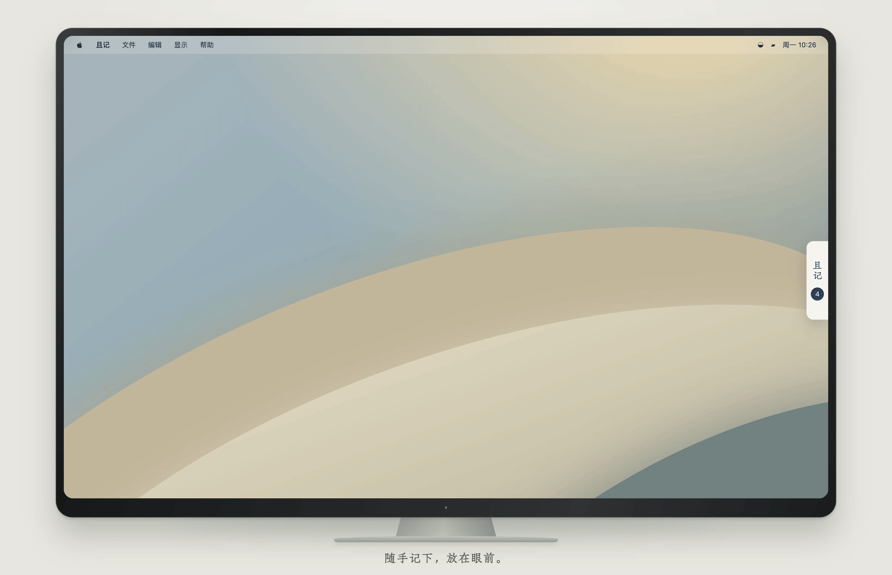

<div align="center">
  
  <h1>且记</h1>
  <p>
    <a href="#演示">演示</a> ·
    <a href="#功能亮点">功能</a> ·
    <a href="#安装">安装</a> ·
    <a href="#快速上手">使用</a> ·
    <a href="#开发">开发</a> ·
    <a href="#许可">许可</a>
  </p>
  <a href="LICENSE"></a>
  
  
</div>

## 关于且记

且记，是一张安放在 Mac 桌边的任务纸。

记下今日要做的事，近日惦念的事，还有那些留待日后慢慢实现的计划。不必细分层级，也无需排满日程，只需随手写下，让每一件事都有处安放。

它静静待在桌边，让惦记的事留在视线里。需要时轻轻提醒，完成后从容划去。偶尔，还可以将清单印在纸上，带着未完成的小事，走进屏幕之外的生活。

**且记于此，余事从容。**

## 演示

<p align="center">
  <a href="docs/images/qieji-demo.mp4"></a>
</p>

<p align="center">展开 → 记录 → 完成 → 打印带走 → 收回桌边</p>

<p align="center"><a href="docs/images/qieji-demo.mp4">观看清晰版视频（22 秒）</a></p>

<sub>使用且记现有界面与虚构任务编排，桌面、指针、窗口转场、打印面板与纸张生成为动画演示。</sub>

## 功能亮点

- **记录**：随手新增、编辑任务，支持文字加粗和底色标记。
- **整理**：按今天、最近、长远分组，完成后划去，也可以拖动排序或跨组移动。
- **提醒**：支持一次性、每天、工作日和每周提醒，显示下一次提醒时间。
- **恢复**：删除撤销、回收站恢复、JSON 导入导出和导入前备份。
- **打印**：将未完成的清单打印成 A4 或保存为 PDF，保留文字格式和勾选框，隐藏提醒信息。

## 安装

适用于 **Apple 芯片 Mac，macOS 14 及以上**。

**[下载 macOS 版](https://github.com/luyaowo/qieji/releases/tag/v0.2.5)** · DMG

### Homebrew

```bash
brew tap luyaowo/qieji https://github.com/luyaowo/qieji.git
brew install --cask luyaowo/qieji/qieji
```

Homebrew 配置随仓库提供，安装包来自同一 GitHub Release。

## 快速上手

1. 点击屏幕右侧的纸边展开清单，选择分组，写下任务并添加。
2. 点任务前的勾选框标记完成；需要集中整理时，切换到“完整窗口”。
3. 需要提醒时，选择时间和频率，再点“设置提醒”保存；首次使用需允许系统通知。
4. 点击打印按钮，打印未完成的任务或保存为 PDF。点右上角“收起到侧边”回到桌边入口。

三条使用规则：

- **分组由你安排**：今天、最近、长远是手动分组，不随日期自动移动；设置提醒也不会改变分组。
- **重复提醒针对同一条任务**：完成后停止，不会自动生成下一周期的新任务。
- **删除可以恢复**：删除和“清理已完成”先移入回收站，永久删除需要单独确认。

任务保存在本机，运行时无需联网或账号，没有云端同步。快捷键、备份、升级和提醒限制见[使用说明](Packaging/使用说明.md)，也可以在应用内打开“帮助 → 使用说明”。

## 开发

且记使用 Swift + AppKit 承载原生窗口，在 WKWebView 中运行本地 React 界面。

构建需要 Apple 芯片 Mac、macOS 14 及以上、支持 Swift 6 的命令行工具、Node.js 18 及以上和 Python 3.9 及以上。通过 Git 克隆仓库后，在项目根目录执行：

```bash
node Scripts/build-frontend.cjs
swift build -c release --arch arm64
```

架构、生成 `.app`、ZIP 与 DMG、检查命令和目录说明见[架构与开发说明](docs/development.md)。开发副本与已安装应用共用任务目录，运行前请阅读其中的数据保护说明。

## 许可

主项目采用 [MIT 许可](LICENSE)，版权归 luyaowo。React、React DOM、Babel 与字体的许可见[第三方许可说明](THIRD_PARTY_NOTICES.md)。

[版本记录](CHANGELOG.md) · [使用说明](Packaging/使用说明.md) · [架构与开发说明](docs/development.md)
