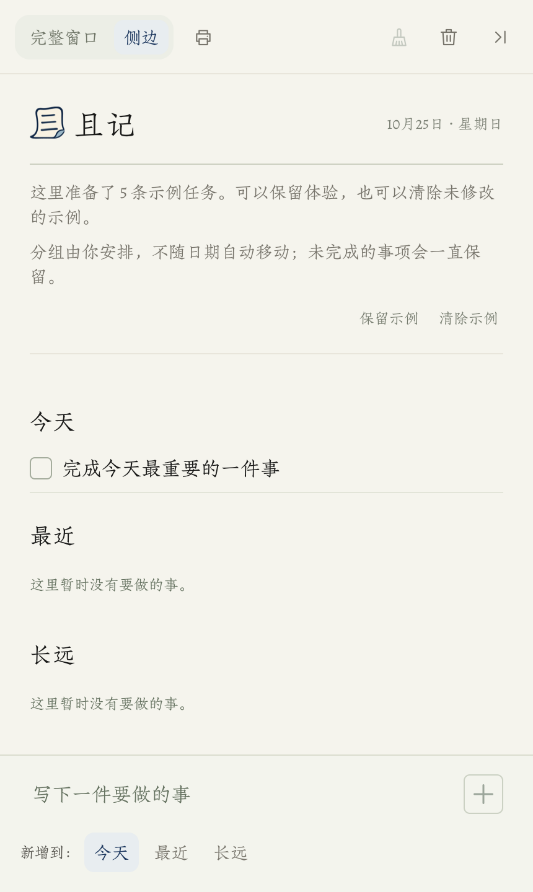
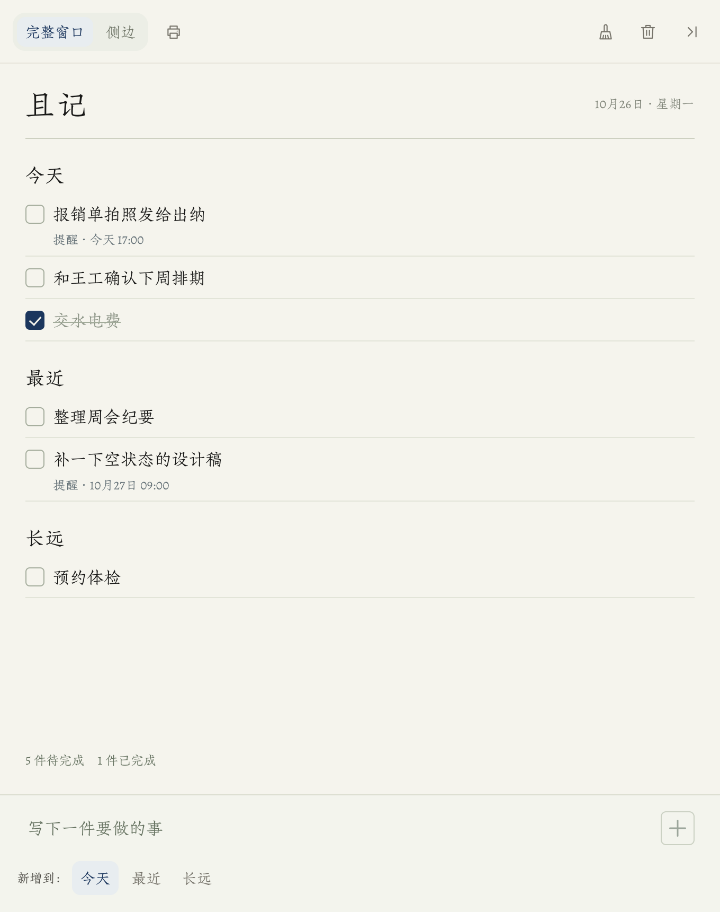
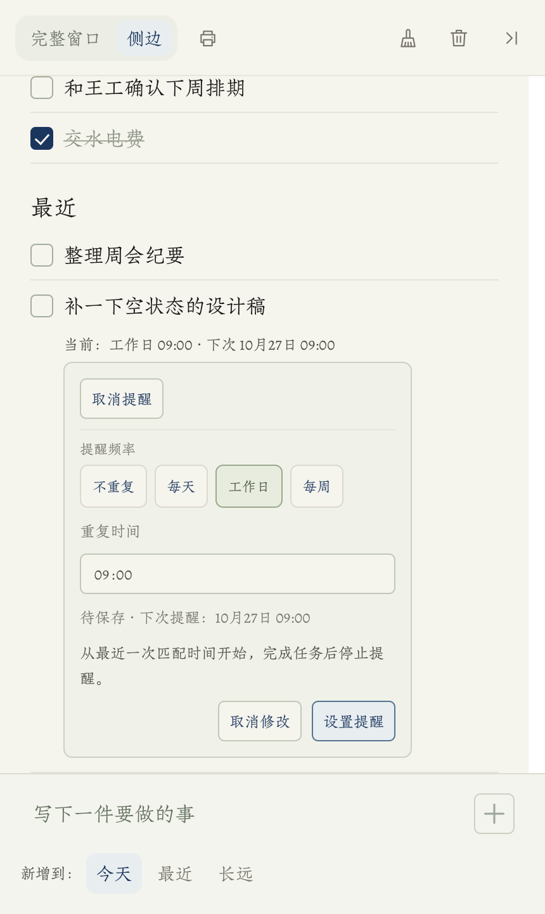
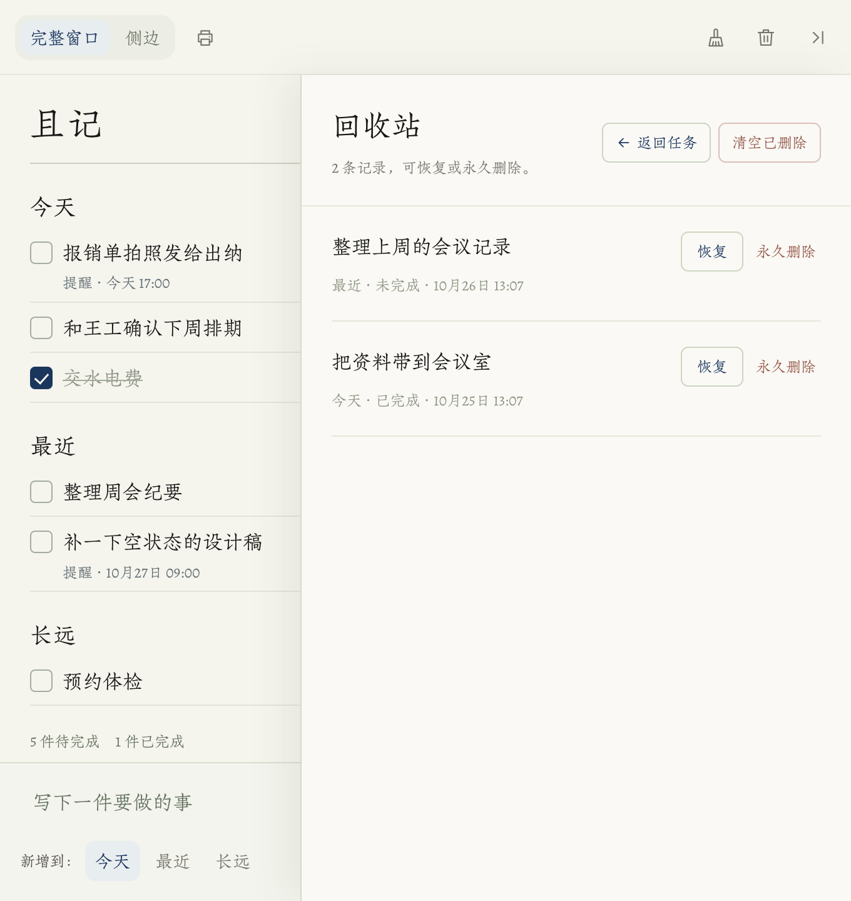

# 且记

一张放在 Mac 桌边的任务纸。随手记下，持续看见，需要时提醒，也能打印带走。

且记把零散待办放在一张清单里：侧边形态方便随手查看，完整窗口用于集中整理。

**当前版本 0.2.4（构建 26），仅支持 Apple 芯片 Mac 和 macOS 14 及以上。** 这个仓库公开的是源码，安装包尚未发布，见[正式分发](#正式分发未完成)。

## 界面

| 侧边形态 | 完整窗口 |
| --- | --- |
|  |  |
|  |  |

截图来自实际运行的界面，使用示例数据，不含真实待办；画面中的日期是截图当天的。

## 已实现的功能

- **记录与整理**：新增任务、编辑文字、加粗和底色、完成与恢复、鼠标拖动排序和跨组移动。
- **两种窗口形态**：侧边收起与展开、完整窗口切换，共用同一份清单和编辑状态。
- **提醒设置**：一次性、每天、工作日和每周提醒，显示下一次提醒时间；所有选择统一点“设置提醒”后生效。
- **恢复与迁移**：删除撤销、回收站恢复、导入前备份，以及 JSON 导入导出。
- **纸面输出**：A4 打印和保存 PDF，隐藏输入区、操作按钮、已完成任务及提醒信息；打印简化不改变应用内提醒设置。
- **离线说明**：从原生菜单“帮助 → 使用说明”打开随包页面。

系统通知的“完成”和“15 分钟后再提醒”动作已实现，真实送达与按钮操作仍有未验完的部分，详见下方验证边界。

## 三条使用规则

**今天、最近、长远由手动安排。** 选择“新增到”的分组决定新任务放在哪里；设置提醒不会移动任务，第二天也不会自动换组或归档。

**重复提醒持续提醒同一条未完成任务。** 它从最近一次匹配的时刻开始，点“完成”后停止，不会自动生成下一周期的任务。

**删除可以恢复。** 删除和“清理已完成”都先移入回收站；永久删除需要单独确认。

## 数据与提醒

任务和回收记录保存在 `~/Library/Application Support/且记/` 的 JSON 工作区，运行时不依赖网络，也不需要账号，没有云端或跨设备同步。导入导出、备份、提醒排查和升级的细节见 [使用说明](Packaging/使用说明.md)。

## 设计取舍

侧边清单用于随手记录和查看，完整窗口用于集中整理；切换形态时复用同一个界面，保留编辑状态。今天、最近和长远由用户手动安排，让任务的位置与提醒时间各自表达清楚。

纸感主要来自暖纸色、朱雀仿宋和留白。屏幕使用独立命名的 QieJi Paper 适配字体，统一字体度量，保留字形与字符宽度；字号、行高和间距集中在样式变量中。打印继续使用原字体，A4 比例只用于纸面输出，隐藏提醒等随时间变化的信息。

## 从源码构建

需要 Apple 芯片 Mac、macOS 14 及以上、支持 Swift 6 的命令行工具、Node.js 18 及以上和 Python 3.9 及以上。前端构建所用 Babel 已随项目保存，无需先安装 npm 依赖。本机验证环境为 macOS 27.0.1、Swift 6.4、Node.js 24.12.0、Python 3.9.6；其他环境仍需验证。

在项目根目录生成前端并编译：

```bash
node Scripts/build-frontend.cjs
swift build -c release --arch arm64
```

生成可运行的本地 `.app` 与 ZIP：

请通过 Git 克隆仓库后打包，并在已登录的 Mac 图形桌面运行；检查和包内校验会打开临时窗口。直接下载的源码 ZIP 不含 Git 仓库，打包脚本会提前提示并停止。

```bash
python3 Scripts/package-mac.py
```

脚本读取 `Packaging/Info.plist`，执行检查、Release 构建、本地 ad-hoc 签名和包内启动校验，然后写入 `dist/`，同时生成来源元数据与 SHA-256。它不会自动安装；同版本产物已存在时会停止，不覆盖。

开发副本与已安装版本共用同一个任务目录，在日常账户运行可能读写现有任务；应在隔离数据环境中验证，避免同时运行普通版和开发副本。

## 开发与检查

日常界面修改以 `Frontend/` 为入口，`Sources/PaperEdgeApp/Resources/scripts/` 与 `styles/` 是生成结果。

```bash
# 检查前端源码与生成资源是否一致
node Scripts/build-frontend.cjs --check

# 运行自动化检查，需要已登录的 Mac 图形桌面
python3 Scripts/check.py
```

检查覆盖前端同步、JavaScript、原生存储与排期、界面与退出保存、窗口切换、生命周期和 PDF。它们使用示例数据，不代替真实通知或另一台 Mac 上的人工验证。运行时会创建临时应用或窗口。

字体已随仓库提供。只有重新生成屏幕适配字体时才需要 `fontTools`，并运行 `Scripts/prepare-mac-font.py`；普通前端构建不执行这个步骤。

| 目录 | 内容 |
| --- | --- |
| `Frontend/` | 本地 React 界面的源码和样式 |
| `Sources/PaperEdgeApp/` | Swift 原生窗口、存储、通知、打印及运行资源 |
| `Scripts/`、`Tests/` | 生成、检查、打包脚本与原生检查 |
| `Packaging/` | 版本信息、图标和随包说明 |
| `docs/` | README 使用的界面截图 |

## 正式分发（未完成）

本项目计划通过 GitHub Releases 分发经 Developer ID 签名和 Apple 公证的安装包。为此需准备 Apple Developer Program 的 Developer ID 证书，完成正式签名、Hardened Runtime、公证与票据附加，再在干净账户或另一台 Mac 上核对下载首启和升级。当前版本只做 ad-hoc 签名，上述步骤均未完成，因此不提供下载。证书私钥、`.p12`、`.p8` 和公证凭据不放入仓库。

## 验证边界

以下检查全部使用示例数据，不包含任何真实用户信息：

- 前端同步、JavaScript、原生存储与提醒排期、窗口切换、生命周期、PDF 输出均有自动化检查。
- PDF 检查覆盖内容、A4、分页、已完成任务和提醒文字隐藏、打印前后提醒数据及屏幕状态。旧同步打印故障另作诊断；在当前系统未复现时仍继续验证现有打印实现。
- 界面在侧边与完整窗口的多种尺寸下检查过长文本、混合状态、提醒面板和格式栏。

尚未验证的部分：

- 选择“15 分钟后再提醒”后，系统记录的动作与实际不符；差异尚未定位，这段路径不保证可用。
- 重复提醒跨周期、跨周末、跨时区、睡眠唤醒后的真实送达。
- 另一台 Mac、干净账户和最低支持系统上的首次使用。
- 实体打印和完整 VoiceOver 流程。
- 签名、公证、下载首启和外部用户试用，详见[正式分发](#正式分发未完成)。

## 字体与许可

界面采用朱雀仿宋，屏幕使用调整字体度量的 QieJi Paper 适配副本，打印保留原字体。原字库与 SIL OFL 1.1 许可保存在 [MacResources](Sources/PaperEdgeApp/MacResources/ZhuqueFangsong-OFL.txt)。React、React DOM 与 Babel 的许可见[第三方声明](Sources/PaperEdgeApp/Resources/vendor/THIRD_PARTY_NOTICES.txt)。

主项目采用 MIT 许可，全文见 [LICENSE](LICENSE)，版权归 luyaowo。第三方代码和字体保持各自版权与许可，见[许可说明](THIRD_PARTY_NOTICES.md)。

[版本记录](CHANGELOG.md) · [第三方许可](THIRD_PARTY_NOTICES.md)
